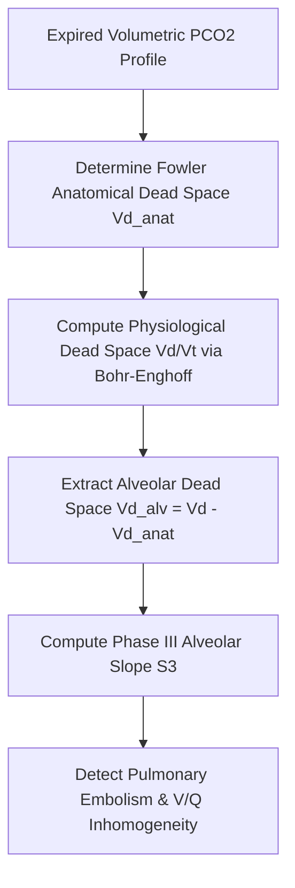

# Pulmonary Volumetric Capnography Dead Space Personal Agent Skill

[](LICENSE)
[](https://www.python.org/)
[]()
[]()
[]()

Deterministic, zero-mock personal agent micro-skill for calculating Fowler Anatomical Dead Space ($V_{D,\text{anat}}$), Physiological Dead Space ($V_D/V_T$), Alveolar Dead Space ($V_{D,\text{alv}}$), and Phase III Alveolar Slope ($S_3$) via volumetric capnography.

## Architecture



## Quickstart

```python
from client import VolumetricCapnographyClient

client = VolumetricCapnographyClient()
result = client.evaluate_volumetric_capnography(
    tidal_volume_ml=500.0,
    arterial_pco2_mmhg=40.0,
    mixed_expired_pco2_mmhg=28.0,
    end_tidal_pco2_mmhg=38.0,
    fowler_inflection_volume_ml=140.0,
    phase3_slope_mmhg_per_l=12.0
)
print(result)
```

## License

Apache-2.0
